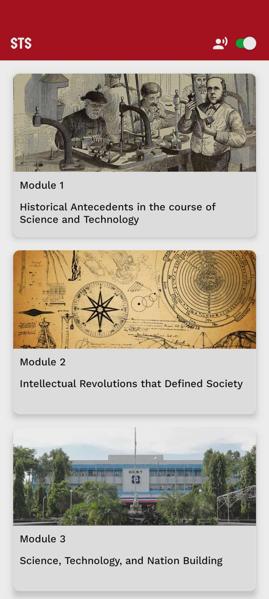

# ModuLearn
Template Expo project for a lightweight mobile app that delivers structured and interactive learning modules.

Modules are created using the companion tool, [ModuLearn Maker](https://github.com/noitisoprepus/modulearn-maker).

### Sample Screenshots
| Module Catalog | Module Content | Quiz Answering | Quiz Results |
|----------------|----------------| ----------------|----------------|
|  |  |  |  |

### Accessibility Features
ModuLearn includes built-in accessibility features to support diverse learners:
- **Text-to-Speech (TTS)**: Uses [Expo Speech](https://docs.expo.dev/versions/latest/sdk/speech/) to read aloud module content and quiz questions for users who prefer auditory learning or have visual impairments.
- **Voice Commands**: Integrated with [expo-speech-recognition](https://github.com/jamsch/expo-speech-recognition) to allow hands-free navigation and control. Users can navigate through modules, answer quiz questions, and control playback using voice commands.

## Getting Started
### Prerequisites
- Node.js (LTS version recommended)
- npm or yarn
- Expo CLI (`npm install -g expo-cli`)
- Android Studio (for Android development) or Xcode (for iOS development)
### Installation
1. Clone or download this template repository
2. Install dependencies:
```bash
npm install
```
### Adding Content
This template expects learning modules in the `/data` folder. Modules are created using the companion tool, [ModuLearn Maker](https://github.com/noitisoprepus/modulearn-maker).
1. Download ModuLearn Maker from the repository above
2. Create your learning modules using the maker tool
3. Export the modules and place them in the `/data` folder
4. The app will automatically load modules from this directory
### Running the App
**Development:**
```bash
# Start Expo development server
npm start
# Run on Android
npm run android
# Run on iOS
npm run ios
```
**Build for Production:**
```bash
# Generate Android APK (with bundled JS)
npx expo prebuild --platform android
cd android && ./gradlew assembleRelease
# Generate iOS build
npx expo prebuild --platform ios
```
### Project Structure
```
/app                   # Expo Router pages
  index.tsx            # Module catalog (home)
  module/[id]/         # Dynamic module routes
    index.tsx          # Module content viewer
    quiz.tsx           # Quiz taking page
    results.tsx        # Quiz results page
/data                  # Learning module files (JSON)
/components            # Reusable UI components
/store                 # Zustand state management
/styles                # Shared styles
utils                  # Helper functions
```
### Customization
- Update app name and configuration in `app.json`
- Modify themes in `styles/`
- Add or modify components in `components/`
- Extend state management in `store/`
